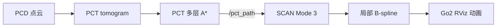

# PCT-SCAN-ROS2

PCT 全局跨层搜索 + SCAN 局部轨迹规划的 ROS 2 Humble 四足导航演示工程。

本工程面向 RViz 视频演示，不依赖 Gazebo 接触物理：PCT 在点云层析图上搜索全局
三维路线，SCAN 沿这条路线滚动生成局部 B-spline，Go2 模型按开环轨迹和步态动画
运动。Start/Goal 可以在 RViz 中通过 Interactive Marker 手动拖动，包括 Z 轴，因此
可以指定跨越多层的路线。



## 已验证场景

| 场景 | 默认路线 | 验证结果 | 启动命令 |
|---|---:|---|---|
| Building | 地面至上层，约 14 m 高差 | PCT 跨层 A* + SCAN 连续跟踪 | `./scripts/launch_pct_scan_building.sh` |
| Plaza | 37.12 m | PCT A*；SCAN 进入持续重规划 | `./scripts/launch_pct_scan_plaza.sh` |
| Spiral | 38.30 m、3.80 m 爬升、2 层 | PCT A*；SCAN 连续 5 个以上窗口 | `./scripts/launch_pct_scan_spiral.sh` |
| Garage | 社区场景，非 PCT 原论文资产 | 保留为可选实验 | `./scripts/launch_pct_scan_garage.sh` |

Plaza 与 Spiral 使用基于 tomogram 距离变换的软中线代价，默认路线的 5% 分位净空
分别为 0.42 m 和 0.40 m。它只影响 A* 在多个可行解之间的选择，不改变 PCT 的
`cost <= 20` 可通行判定。Building、Plaza、Spiral 是 PCT 论文/官方仓库列出的三种
场景；RMUC 是 ROS 2 分支后来添加的配置，不在本工程的“论文场景稳定演示”范围内。

## 环境与构建

支持 Ubuntu 22.04、ROS 2 Humble、Python 3.10 和 C++17。先安装 ROS/SCAN 系统依赖：

```bash
sudo apt update
sudo apt install -y \
  python3-colcon-common-extensions python3-rosdep ninja-build \
  libarmadillo-dev libglew-dev libglfw3-dev libgl1-mesa-dev libglu1-mesa-dev

rosdep update
rosdep install --from-paths src --ignore-src -r -y
```

PCT 的 C++ 核心依赖 GTSAM 4.2 和 OSQP 1.0。源码和安装结果会放在本仓库被 Git
忽略的 `.deps/`，不再要求 source 另一个 PCT 工作空间：

```bash
./scripts/setup_pct_dependencies.sh
./scripts/build_workspace.sh
source install/setup.bash
```

已有依赖安装时也可以显式指定：

```bash
PCT_DEPS_ROOT=/path/to/deps ./scripts/build_workspace.sh
```

## 快速演示

先做无界面的 PCT 路线验收：

```bash
./scripts/test_pct_building_astar.sh --force
./scripts/test_pct_plaza_astar.sh --force
./scripts/test_pct_spiral_astar.sh --force
```

再启动任一场景：

```bash
./scripts/launch_pct_scan_building.sh
./scripts/launch_pct_scan_plaza.sh
./scripts/launch_pct_scan_spiral.sh
```

在 RViz 中：

1. 选择工具栏的 `Interact`。
2. 拖动绿色 Start 和红色 Goal；跨层时用蓝色 Z 轴移动到目标楼层。
3. 右键任一 marker，选择 `Plan route`。
4. 观察 `/pct_path` 全局路线、SCAN 局部轨迹和 Go2 动画。

需要固定端点自动播放时：

```bash
./scripts/launch_pct_scan_spiral.sh plan_on_startup:=true
```

视频模式默认 `enable_local_sensing:=false`。PCD 仍用于场景显示和 PCT 地形代价；
关闭 SCAN 的稠密点云碰撞膨胀可避免楼梯踏步被误当成封闭障碍。这里验证的是规划与
轨迹跟踪，不等价于接触动力学、足端落脚或真机低层 policy 验证。

## Spiral 资产

Building 和 Plaza 资产来自 PCT 官方资源，并保留 GPL 上游说明。Spiral 来自 3D2M
planner，但其仓库当前没有明确许可证，因此本项目不把 Spiral PCD/派生数据提交到
Git。请在本地下载并用 CPU 生成 tomogram：

```bash
./scripts/fetch_spiral_asset.sh
./scripts/setup_tomography_env.sh
./scripts/generate_spiral_tomogram.sh
./scripts/test_pct_spiral_astar.sh --force
```

生成器会优先使用 CUDA；GPU 驱动不可用时自动回退到等价的 NumPy/SciPy 实现。
校验值和资产来源见 `assets/<scene>/README.md`。

## 工程结构

```text
PCT-SCAN-ROS2/
├── src/pct/                         # 可构建的 PCT/tomography 源码
├── src/integration/pct_scan_bridge/ # PCT → SCAN ROS 2 桥
├── src/planner/                     # SCAN planner
├── src/simulator/                   # Go2 RViz 动画及原 SCAN 工具
├── assets/                          # 场景、tomogram、验收路线与来源说明
├── scripts/                         # 依赖、生成、测试和启动入口
├── docs/                            # 分阶段教程
├── LICENSES/                        # 上游许可证全文
└── NOTICE                           # 来源与修改声明
```

核心接口：PCT 发布 `/pct_path` (`nav_msgs/Path`)；SCAN Mode 3 订阅后进行三维 RDP
简化和分段线性参考参数化，再发布 `planning/bspline`。分段线性参考用于守住楼梯和
窄通道的全局走廊，平滑只由局部 B-spline 完成。

更完整的原理和调试过程见：

- `docs/tutorial_phase4_pct_scan_bridge.md`
- `docs/tutorial_phase5_route_tracking.md`
- `docs/tutorial_phase7_building_rviz.md`

## 来源与许可证

- SCAN-Planner：<https://github.com/wuyi2121/SCAN-Planner>，Apache-2.0。
- PCT planner：<https://github.com/byangw/PCT_planner>，其 NOTICE 明确为 GPL v2
  或后续版本。
- PCT ROS 2 移植来源：<https://github.com/2473o/PCT_planner/tree/feat/ros2pkg>。
- Spiral/3D2M：<https://github.com/ZJU-FAST-Lab/3D2M-planner>，当前未发现明确
  许可证，因此不随 Git 分发其资产。

本仓库不是一个可以用单一 Apache-2.0 覆盖所有文件的工程。SCAN 包继续使用
Apache-2.0；PCT、tomography 和直接派生的 bridge 使用 GPL-2.0-or-later；其他
ROS 包保留各自 package.xml 声明的 GPL-3.0-only 或 BSD-3-Clause。完整映射见
[`LICENSE`](LICENSE)、[`NOTICE`](NOTICE)、`src/pct/NOTICE` 和 `LICENSES/`。

这是一份工程侧许可证审计，不构成法律意见。公开发布或商业使用前应再次核对每个
第三方 asset 与依赖的授权条件。
